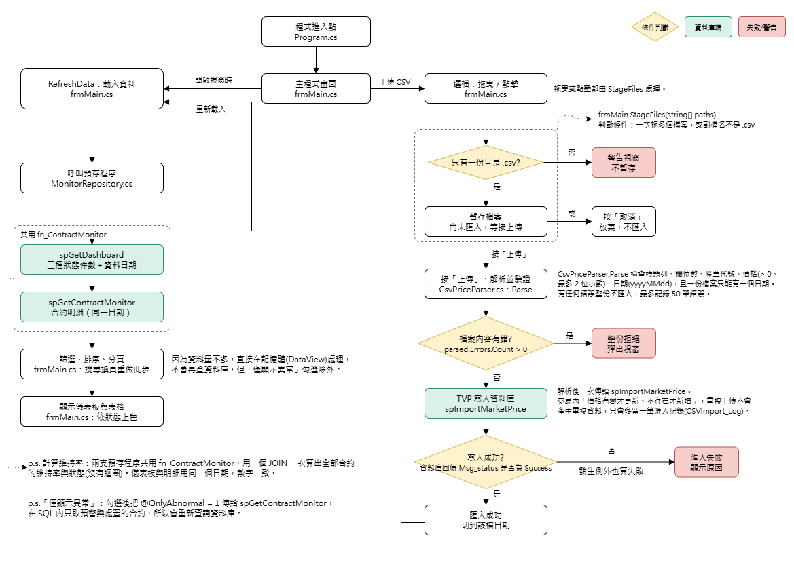

# 題目二：借券擔保品「維持率」監控與異常作業平台

C# WinForm(.NET Framework 4.8) + SQL Server。上傳外部收盤價 CSV 後，由資料庫一次比對全部合約並算出維持率，畫面以顏色呈現正常／預警／處置。

## 執行說明

環境：Windows、支援 `.slnx` 的 Visual Studio(2022 17.13 以上，或直接用 MSBuild)、.NET Framework 4.8、SQL Server(開發與測試使用 SQL Server 2025 Developer Edition，預設連 `.`，Windows 驗證)。

1. 建立資料庫與物件(可重複執行)：用 SSMS 連線到本機 .(Windows 驗證)，用「檔案 → 開啟 → 檔案」依序開啟 db\01_schema.sql、db\02_seed.sql，各按一次「執行」(F5)。要先執行 01 再執行 02。
2. 連線字串在 `prjSBLCollateral\App.config` 的 `SBLCollateralDB`，不是本機預設執行個體請自行修改。
3. 用 Visual Studio 開啟 `slnSBLCollateral.slnx` 後執行。
4. 把 `sample\Market_Price_20260424.csv` 拖到畫面上方的框線區域(或點一下選檔)，再按右側「上傳」；再拖 `Market_Price_20260427.csv` 看價格變動後的狀態變化。`Market_Price_invalid.csv` 用來看錯誤提示。

| 範例檔 | 用途 |
|---|---|
| `Market_Price_20260424.csv` | 50 檔標的的基準日收盤價 |
| `Market_Price_20260424_revised.csv` | 5 檔標的更正 0424 的價格，驗證「已存在則更新」 |
| `Market_Price_20260427.csv` | 另一天的價格(50 檔)，驗證依日期比對 |
| `Market_Price_invalid.csv` | 含空白代碼、負數、非數字、日期格式錯誤、欄位數不對，驗證整份拒絕 |
| `Market_Price_20260428_1000.csv` | 1,000 檔標的的價格(其中 50 檔是合約借的標的，其餘只存入價格表)，驗證較大的檔案也能順利匯入 |

測試資料共 1,000 筆合約(`02_seed.sql` 用 set-based 一次產生，執行會先清空合約表再重建)：

- 993 筆：合約編號為 `CT` + 開約日(只是編號的一部分，與收盤價的交易日無關；0401～0420，前 19 天每天 50 筆，0420 為 43 筆) + 2 位流水號，與題目範例同格式；50 檔標的、借出 1～60 張。擔保比例在各區間內連續分布，約 80% 正常、14% 預警、6% 處置，比較接近實務(多數合約安全，少數接近或低於門檻)。
- 7 筆手動邊界案例(編號 `CT2026042401`～`CT2026042407`)：剛好 120%／140%、119.99%／139.99%、顯示 120.00／140.00 但原始值未達的兩筆、最小單位 1 張。

測試資料是我用 set-based 的 SQL 產生的，目的是涵蓋三種狀態和邊界情況。程式不依賴這些數字，換一批資料也一樣能算。

預期結果(依序匯入時，儀表板的 正常／預警／處置，合計皆為 1,000)：

| 匯入 | 資料日期 | 正常 | 預警 | 處置 |
|---|---|---|---|---|
| `Market_Price_20260424.csv` | 2026-04-24 | 796 | 142 | 62 |
| 再匯入 `..._revised.csv` | 2026-04-24 | 763 | 160 | 77 |
| 再匯入 `Market_Price_20260427.csv` | 2026-04-27 | 767 | 160 | 73 |

勾選「僅顯示異常」只顯示預警與處置，筆數等於儀表板這兩項相加(例如 0427 為 233 筆)。

## 維持率公式與狀態

```
維持率(%) = 擔保品總市值 × 100 ÷ (借出數量(張) × 1000 × 收盤價)
```

| 條件 | 狀態 | 顏色 |
|---|---|---|
| < 120% | 處置 (Call) | 紅 |
| 120% ≤ x < 140% | 預警 (Warning) | 黃 |
| ≥ 140% | 正常 (Normal) | 綠 |

1 張 = 1000 股，分母為借出標的市值(借出數量 × 1000 × 今日收盤價)，與題目補充的公式一致。

**假設：** 價格檔涵蓋所有借出標的。函式以 `INNER JOIN` 比對當日收盤價，當日沒有價格的合約不納入計算；尚未匯入任何價格時，儀表板為 0、表格為空並提示先上傳 CSV。

## 架構設計理由



- **計算全部放資料庫，用 Set-based。** `fn_ContractMonitor(@TradeDate)` 是 inline 資料表值函式，一個 JOIN 就算出所有合約的維持率與狀態；儀表板 `spGetDashboard` 與明細 `spGetContractMonitor` 共用它，兩邊的數字不可能不一致。沒有逐筆迴圈，也不在 C# 端重算。
- **金額全程 `decimal`。** 資料庫用 `DECIMAL(18,2)`，C# 用 `decimal` 解析 CSV，不經過 `double`。公式先乘 100 再除，保留精度。
- **狀態用未四捨五入的值判斷。** 畫面顯示 2 位小數，但 119.996% 顯示為 120.00 時狀態仍是「處置」，避免四捨五入把應追繳的合約漏掉。
- **CSV 用 TVP 一次傳入。** C# 解析後以 `Market_Price_Type` 資料表值參數交給 `spImportMarketPrice`，一次往返，不逐筆 INSERT。
- **匯入具冪等性。** 主鍵為 `(Trade_Date, Stock_ID)`，預存程序在交易中「價格有變才 UPDATE、不存在才 INSERT」，同一份檔重複上傳不會產生重複資料(第二次全部略過)。每次匯入寫一筆 `CSVImport_Log` 供稽核，`Market_Price.Import_ID` 可追到是哪次匯入寫的。`XACT_ABORT ON` 加交易，失敗整批回滾。
- **CSV 嚴格驗證、整份拒絕。** 標題列、欄位數、代碼、價格(>0、最多 2 位小數、不接受千分位)、日期(`yyyyMMdd`)都檢查，且一份檔案只能有一個資料日期(一份檔案就是一天的收盤價，題目公式用的是「今日收盤價」)；有任何一行錯就整份不匯入並列出行號，避免價格只匯入一半造成誤判。同檔內重複的 (標的, 日期) 以最後一筆為準。
- **預設用最新交易日；匯入後切到該檔日期。** 明細與儀表板用同一個日期查詢，避免兩邊日期不同。
- **索引。** `Lending_Contract(Stock_ID) INCLUDE (Borrowed_Qty, Collateral_Val)` 讓依標的比對價格不必回表。
- **UI。** 解析與寫入用 `async/await` 放背景執行，畫面不會凍結，匯入中顯示等待游標並停用拖曳，匯入結果同時顯示在上傳區(成功綠字顯示新增/更新/略過筆數、失敗紅字)與底部狀態列(內容與資料庫相同時註明重複上傳不會產生重複資料)，失敗另外彈出視窗列出檔名與原因；上傳區可拖曳也可點擊選檔，選好只是暫存，按「上傳」才真正匯入、按「取消」放棄(避免誤拖誤匯入)，一次只能上傳一份 CSV(一份檔案就是一天的收盤價)；點上方「正常／預警／處置」色塊可只看該狀態、再點取消，另有「僅顯示異常」開關(預警＋處置)；可用合約編號或標的代碼搜尋；表格分頁，預設每頁 20 筆(可改 50／100／200)，搜尋、篩選、排序都對全部資料處理後再分頁，皆在記憶體的 `DataView` 進行(「僅顯示異常」除外，它在 SQL 內處理，勾選或取消後會重新查詢)，換頁不重打資料庫；點欄位標題可排序；異常排在最前面；維持率欄以 `CellFormatting` 上色並以欄位綁定名稱判斷；底部狀態列固定顯示目前顯示的筆數範圍，沒有收盤價時表格上提示先上傳 CSV。

## 專案結構

```
db\01_schema.sql      資料庫、資料表、TVP、函式、預存程序
db\02_seed.sql        測試合約
sample\               範例 CSV
prjSBLCollateral\
  frmMain.cs          畫面：儀表板、明細、過濾、拖曳上傳、上色
  CsvPriceParser.cs   CSV 解析與驗證
  MonitorRepository.cs 呼叫預存程序
```
